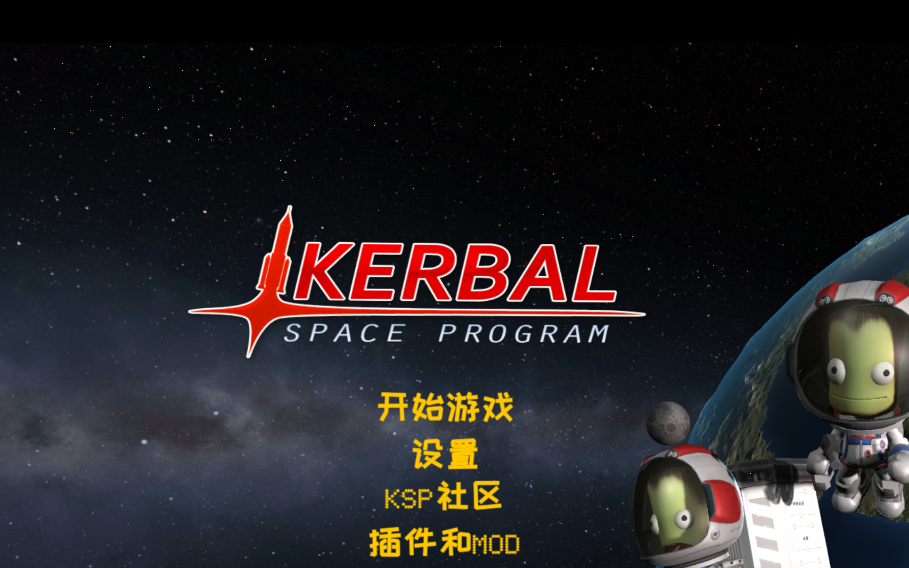

# KSP-ZH-CN-Extended

**坎巴拉太空计划 · 中文扩展汉化包**（Kerbal Space Program Simplified Chinese Localization Extension）

仓库：<https://github.com/ks-jiang502/KSP-ZH-CN-Extended> · 下载：<https://github.com/ks-jiang502/KSP-ZH-CN-Extended/releases>

本模组为 KSP 1.12.x 的一批常用插件补充简体中文翻译，分两层：

1. **配置层（v1.3.0）**：Cormorant Aeronology、VABOrganizer、KIU、KIS/KAS、ChromaWorks、JamesWebb、RealChute、IndicatorLights、JSI、ASET、FreeIva、KSP_Proximity、KerbalTelemetry、SquadExpansion 等 16 个模组的部件名称、描述、厂商、实验、资源、机构与变体。
2. **运行时 DLL 层（v1.3.0）**：Harmony 插件 `KSPZHCN.dll` 在渲染前替换各模组程序集里硬编码的界面文字（窗口标题、按钮、提示、状态栏等），词库位于 `DllLocalization/zh-cn.txt`。

- 不修改任何原模组文件，配置层全部通过 `ModuleManager` 补丁与独立 `Localization` 文件实现
- 与 `0000Tinygrox_CNPatches` 等现有汉化包共存，不覆盖、不冲突
- 英文原文完整保留：切换回 English 时显示原文本；DLL 层另有开关可整体关闭
- 开源、可自行增补：所有词条集中在 `GameData/KSP-ZH-CN-Extended/Localization/` 与 `DllLocalization/`，补丁集中在 `Patches/`

## 安装

1. 确认已安装 **ModuleManager 4.x**（本包依赖它来应用补丁）。
2. 将压缩包内的 `GameData` 文件夹合并到 KSP 安装目录（例如 `D:\SteamLibrary\steamapps\common\Kerbal Space Program\`）。
3. 启动游戏，在 **Settings → Language** 中选择 **简体中文 (zh-cn)**。
4. 进入 VAB/SPH 或载入存档，部件名称、描述、实验名称、资源名称等即显示中文。

实机效果（插件加载后的主菜单）：



安装后的目录结构：

```
GameData/
└── KSP-ZH-CN-Extended/
    ├── KSP-ZH-CN-Extended.version
    ├── Localization/
    │   ├── zh-cn.cfg
    │   └── en-us.cfg
    ├── Patches/
    │   ├── Bluedog_DB.cfg
    │   ├── Tantares.cfg
    │   ├── WildBlueIndustries.cfg
    │   └── ...
    ├── Plugins/
    │   └── KSPZHCN.dll
    └── DllLocalization/
        └── zh-cn.txt
```

## DLL 界面汉化（v1.3.0）

`Plugins/KSPZHCN.dll` 是独立 Harmony 插件，启动时读取 `DllLocalization/zh-cn.txt`，对 76 个方法注册前缀补丁：

- `UnityEngine.GUI` / `GUILayout` 的 `Label`、`Box`、`Button`、`TextField`、`Toggle`、`Window`、`BeginGroup` 等字符串重载
- `GUIContent` 构造函数、`text` / `tooltip` 属性，`UnityEngine.UI.Text` 与 `GUIContent.Temp`
- `ScreenMessages.PostScreenMessage` 的屏幕提示
- KSP 对话框 `DialogGUILabel`、`DialogGUIButton`、`MultiOptionDialog`

词库为 `原文<TAB>译文` 的 UTF-8 文本，共 **1,331 条**，来自对本次更新后模组 DLL 的 IL 分析。启动后可在 `KSP.log` 中确认：

```
[KSPZHCN] dictionary loaded: 1331 entries
[KSPZHCN] harmony patches: ok=76 fail=0
```

- 关闭插件：在 `DllLocalization/` 下新建空文件 `disabled.txt`，重启游戏即可。
- 增补词条：直接在 `zh-cn.txt` 末尾追加 `原文<TAB>译文`（`#` 开头为注释），重启生效。
- 若某些模组界面显示乱码或异常，请先确认 `KSP.log` 中的补丁统计，再提交 Issue。

**v1.1.2 说明**：MechJeb2 自带完整中文界面，其条目已从运行时词库移除（v1.1.1 及更早版本会重复翻译它）。

**v1.1.1 卡顿修复**：v1.1.0 的忽略大小写查找使用 `StringComparer.OrdinalIgnoreCase`，Mono 运行时对部分界面字符串会在 `TextInfo.GetInvariantCaseInsensitiveHashCode` 内抛 `NullReferenceException`，被 MechJeb / RemoteTech 等每个控件每帧触发，造成飞行界面严重卡顿。v1.1.1 改为预构建小写词表 + 序号比较，并移除了可变缓存、给所有前缀加了异常兜底，词库加载后只读、线程安全。

## 覆盖范围（v1.3.0）

针对当前安装的模组库（58 个含配置的模组目录 / 72 个 CKAN 模块）重新审计后，本包新增：

- **284 条**待译文本 → **313 条**中文本地化词条（`en-us.cfg` 229 条）
- **93 个部件**、**70 个部件变体**、**5 个配置节点**
- **13 个** ModuleManager 补丁文件
- 运行时 DLL 词库 **1,331 条**（复用 1,079 条 + 新译 252 条）

本次实际写入中文的模组（含版本号，完整表格见 [docs/汉化模组清单.md](docs/汉化模组清单.md) 与 `docs/汉化模组清单.csv`）：

| 模组 | 版本 | 标签 | 部件 | 变体 | 节点 |
| --- | --- | --- | --- | --- | --- |
| Cormorant Aeronology | 1.12.5b | 0 | 60 | 0 | 1 |
| VABOrganizer | 1.2.0 | 30 | 0 | 0 | 0 |
| KIU（中国运载火箭包） | 1.1.12 - Hotfix | 0 | 1 | 44 | 0 |
| KIS | 1.29 | 19 | 0 | 1 | 0 |
| ChromaWorks | 2.0.1.2 | 0 | 16 | 0 | 0 |
| KAS | 1.12 | 10 | 0 | 0 | 0 |
| JamesWebb | 1.12.x | 0 | 6 | 0 | 0 |
| RealChute | v1.4.10.1 | 0 | 4 | 0 | 2 |
| SquadExpansion | 原版 DLC | 0 | 0 | 25 | 0 |
| IndicatorLights | 1.8.3 | 0 | 1 | 0 | 1 |
| JSI / RasterPropMonitor | 1:v1.1.0.1 | 0 | 2 | 0 | 0 |
| ASET Props | v2.0.7 | 0 | 0 | 0 | 1 |
| FreeIva | 0.2.20.2 | 1 | 0 | 0 | 0 |
| KSP_Proximity | 0.3.3.3 | 0 | 1 | 0 | 0 |
| KerbalTelemetry | v2.4.0 | 0 | 1 | 0 | 0 |
| Squad（原版） | 原版 | 0 | 1 | 0 | 0 |

> 其余已安装模组大多自带 `zh-cn` 词条（如 KIU、Kerwis 中国航天包、KIS/KAS、Chatterer、MechJeb2 等），或由 `0000Tinygrox_CNPatches`（ChineseModPatches v1.8.5）覆盖；本包只补充缺口。
> 版本号来自 CKAN 注册表；手动安装/原版目录标注“—”。

运行时 DLL 层（`DllLocalization/zh-cn.txt`，1,331 条）覆盖 Chatterer、FreeIva、B9PartSwitch、KIS、KAS、RCSBuildAid、Trajectories、WaypointManager、VABOrganizer 等程序集的界面字符串；MechJeb2 自带中文，仍保持排除。

## 已知限制

- **DLL 层词库基于启发式提取**：只收集 IL 中紧邻 GUI 调用点的字符串常量，运行时拼接、格式化或从配置文件读取的文本可能仍是英文；可在 `zh-cn.txt` 中手动补充。
- **搜索关键词（tags）**：部分标签的中文译文会替换原有英文关键词，中文搜索更友好，但可能影响英文关键词检索。
- 配置层已通过静态校验（括号平衡、标签引用、占位符、空值检查）；DLL 层已验证插件加载、76 个补丁全部注册成功、主菜单无异常，v1.1.1 修复了 v1.1.0 的每帧 `NullReferenceException` 卡顿问题，但未对所有模组的每个窗口逐一点击验证。如发现漏译、错译或卡顿，请先附上 `KSP.log` 提交 Issue。

## 卸载

删除 `GameData/KSP-ZH-CN-Extended/` 文件夹即可，不会影响原模组。

## 构建与贡献

- 词条文件：`GameData/KSP-ZH-CN-Extended/Localization/zh-cn.cfg`（`Localization { zh-cn { #标签 = 文本 } }`）。
- 补丁文件：`GameData/KSP-ZH-CN-Extended/Patches/<模组>.cfg`，均带 `:NEEDS[模组]` 与 `:FINAL`，仅在对应模组存在时生效。
- 字面量字段采用“标签间接”方案：补丁把 `title/description/manufacturer/displayName` 指向 `#LOC_KSPZH_<id>`，英文原文写入 `en-us.cfg`，中文写入 `zh-cn.cfg`，因此切换语言不会串味。
- 新增翻译时请保持 `<<1>>`、`<color=...>`、`\n`、`%s`、`{0}` 等占位符与原文一致。
- DLL 插件源码在 `Source/KSPZHCN/`（`Translator.cs`、`Patches.cs`、`Bootstrap.cs`、`Util.cs`）。使用 .NET Framework 4.x 的 `csc.exe` 编译：

```bat
csc /target:library /langversion:5 /out:GameData\KSP-ZH-CN-Extended\Plugins\KSPZHCN.dll ^
  /r:"<KSP>\KSP_x64_Data\Managed\Assembly-CSharp.dll" ^
  /r:"<KSP>\KSP_x64_Data\Managed\UnityEngine.dll" ^
  /r:"<KSP>\KSP_x64_Data\Managed\UnityEngine.CoreModule.dll" ^
  /r:"<KSP>\KSP_x64_Data\Managed\UnityEngine.IMGUIModule.dll" ^
  /r:"<KSP>\KSP_x64_Data\Managed\UnityEngine.UIModule.dll" ^
  /r:"<KSP>\KSP_x64_Data\Managed\UnityEngine.UI.dll" ^
  /r:"<KSP>\GameData\000_Harmony\0Harmony.dll" ^
  Source\KSPZHCN\*.cs
```

- 新增 DLL 词条：直接编辑 `DllLocalization/zh-cn.txt`，每行 `原文<TAB>译文`；新增补丁点请改 `Source/KSPZHCN/Patches.cs` 后重新编译。

## 许可

MIT License，详见 [LICENSE](LICENSE)。翻译文本基于各原模组的英文原文创作；原模组版权归各自作者所有，本包不包含任何原模组代码或资源。

## 致谢

- [tinygrox/KSP_Mod_Localization_Guide](https://github.com/tinygrox/KSP_Mod_Localization_Guide)：本地化方法与规范
- 所有被翻译模组的作者
- KSP 中文社区
